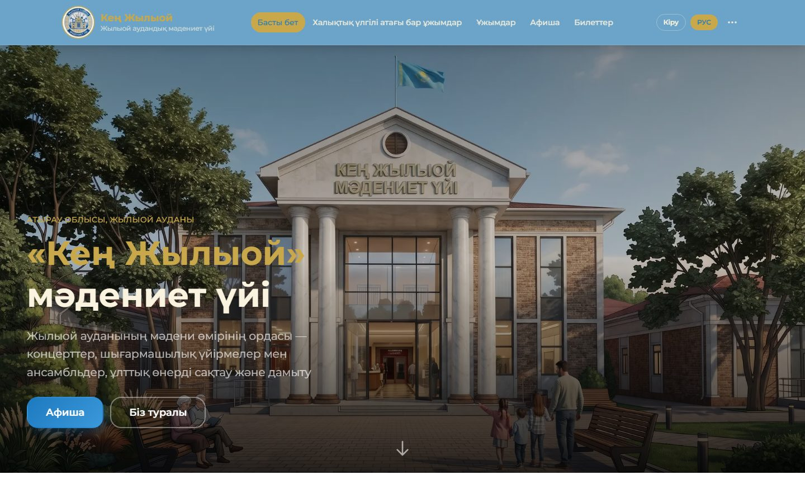
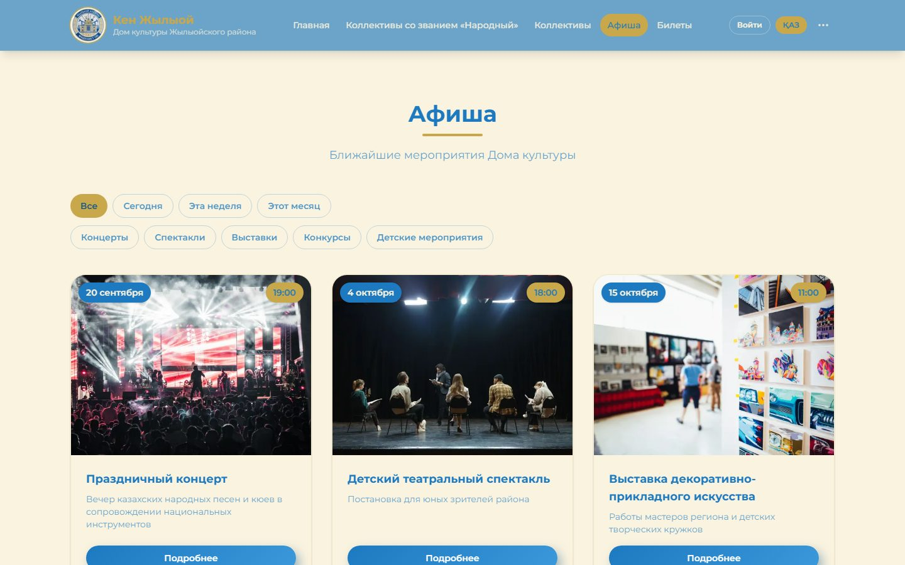

# Кең Жылыой — Culture Platform with Online Ticketing

Website and ticketing system for the «Кең Жылыой» House of Culture (Zhylyoi district, Atyrau region, Kazakhstan). Visitors browse the events calendar, pick seats on a hall map, pay through the bank and get QR tickets; staff scan them at the door. Everything is managed from an admin panel, in Kazakh and Russian.

The data model is built as a **platform for many institutions** (houses of culture, libraries, sport departments of the region), not a one-off site.

**Live site:** https://culture-portal-kz-production.up.railway.app  
**Events (RU):** https://culture-portal-kz-production.up.railway.app/ru/afisha

<p>
  
  
</p>


**Stack:** Next.js 16 (App Router) · TypeScript · Supabase (PostgreSQL, Auth, RLS) · next-intl (KZ / RU) · pdf-lib · Vitest · Railway

**Scale:** 276 TypeScript files · 69 SQL migrations · 10 test suites · 260+ commits

---

## Features

### Public site
- Events calendar with filters (today / week / month, concerts, plays, exhibitions, contests, kids)
- Folk ensembles with the «Народный» title, creative collectives and clubs, repertoire, news, video, staff
- Fully bilingual: Kazakh and Russian, per-locale routes (`/ru/...`)

### Ticketing
- Seat selection on hall maps; seats are held for 15 minutes while the order is pending
- **No double selling:** a unique DB index allows only one active ticket per seat per event
- Personal order page by a long secret token — no account required
- PDF tickets (one A5 page per seat, Kazakh or Russian) with QR code and manual entry code
- QR check-in for staff at the door; check-ins are append-only
- Sales statistics per event

### Payments
- **Only the bank marks an order as paid.** The success page and the browser prove nothing; the order is settled in one DB function after the bank adapter verifies the webhook signature (or the bank confirms the status on request)
- Signed webhooks with stored body fingerprints, reconciliation of stuck payments, refunds
- Card data never touches the site; bank keys live in a table closed to the browser

### Operations
- Telegram bot: new orders go to the institution's cashier chat with confirm / reject buttons; the webhook checks Telegram's secret, and the DB decides who may act on which order
- Admin panel (CMS) for events, halls, news, collectives, clubs, staff, videos, repertoire, applications and site settings

---

## Engineering notes

- **Security in the database, not only in the UI** — Row Level Security on tables, privileged operations in server-side functions, service key only on the server.
- **Naming as architecture** — content tables are `{domain}_{entity}` (`culture_events`, `culture_news`, later `library_*`, `sport_*`) so new institution types plug in without schema collisions.
- **Graceful deploys** — the app is started with `node …/next start` instead of `npm start`, so Railway's `SIGTERM` reaches Next directly, in-flight requests finish and the process exits with code 0 (no false "Deploy crashed" alerts).
- **Tests** cover the money and ticket paths: payment creation and pipeline, seat categories, event locks, PDF tickets, rate limiting, phone and time-zone handling.
- Design docs: [`docs/tickets.md`](docs/tickets.md), [`docs/payments.md`](docs/payments.md), [`docs/webhooks.md`](docs/webhooks.md) (RU).

```
src/
├── app/
│   ├── [locale]/      Public site: afisha, tickets, collectives, news, my-ticket, …
│   ├── admin/         CMS + ticketing back office (halls, orders, payments, scan, stats)
│   └── api/           Payments (create, webhook, reconcile), tickets PDF, Telegram webhook
└── lib/               Payments, ticketing, PDF, Telegram, Supabase clients
supabase/migrations/   Database schema, RLS policies and functions
docs/                  Ticketing, payments and webhook design (RU)
```

---

## Running locally

```bash
npm install
npm run dev      # http://localhost:3000
npm test         # Vitest
```

Needs a Supabase project: apply `supabase/migrations/` and set the Supabase URL and keys in `.env.local`.

## Deployment

Hosted on Railway; the start command is set in `railway.json` (see `AGENTS.md` for why it bypasses npm).
